# GTM Growth: the Growth Marketing + AI stack

Ten go-to-market folders, first touch to final report. Every item running in production today.



**72 live systems:** 11 AI agents · 14 skills · 33 loops · 14 automations.

Built by [Michael Soto, The Innovative Native](https://theinnovativenative.com). This repo shows **what each system does and the outcome**, folder by folder. How they're built (the prompts, the agent design, the wiring) stays private.

## The ten folders

| Folder | What it does | Live items |
|---|---|---|
| [01 · Market Research](01-market-research/) | Every sales call becomes a weekly read of objections, strengths and competitors. | 1 |
| [02 · Positioning & Offer](02-positioning-and-offer/) | Channel strategy, brand voice and offer tests set before a dollar is spent. | 5 |
| [03 · Content Engine](03-content-engine/) | One sentence in, finished scripts and edited reels out, on brand. | 10 |
| [04 · Paid Media](04-paid-media/) | Every platform's results land daily, and sales flow back so ads optimize for revenue. | 6 |
| [05 · Capture & Consent](05-capture-and-consent/) | Every consent sealed with its exact wording, provable on demand. | 5 |
| [06 · Speed to Lead](06-speed-to-lead/) | AI answers every call and chat, routes it, and hands it to a person. | 10 |
| [07 · Sales Floor](07-sales-floor/) | Every call transcribed and scored daily, with training on tap. | 5 |
| [08 · Attribution & Cost](08-attribution-and-cost/) | Every dollar of spend proven before it reaches the CRM. | 9 |
| [09 · Reporting Cockpit](09-reporting-cockpit/) | One screen where the numbers refresh themselves and answer back. | 10 |
| [10 · Reliability](10-reliability/) | Nothing fails quietly: jobs heal, stall alarms fire, data gates hold. | 11 |

## By kind

| | |
|---|---|
| **Agents**: AI seats that hold a growth role: strategy, media buying, editing, analysis, review. |  |
| **Skills**: Repeatable playbooks an agent loads on demand: voice, video, QR, data rules, audits. |  |
| **Loops**: Scheduled jobs that run daily or weekly with no one pressing a button. |  |
| **Automations**: Always-on systems: AI answering, consent register, cockpit, classroom. |  |

GIF versions for social posts are in [`assets/gif/`](assets/gif/). Phone-shaped SVGs are the `-mobile.svg` files.

## Where the field leaves gaps

A survey of public GTM agent, skill and automation repos ([research/external-gtm-repos.md](research/external-gtm-repos.md)) finds roughly the same ten stages, and five areas almost nobody covers. This stack is built around them:

1. **Consent capture and proof:** see [05 · Capture & Consent](05-capture-and-consent/) and the free [Outside Consent Register field guide](https://theinnovativenative.com/guides/outside-consent-register).
2. **Attribution tie-out:** spend proven against the CRM before it is reported ([08](08-attribution-and-cost/)).
3. **Call-floor analytics:** every sales call transcribed and scored daily ([07](07-sales-floor/)).
4. **Loud failure:** nothing fails quietly ([10](10-reliability/)).
5. **Governed writes:** agents stage changes and a person approves them.

## Featured

- **The Outside Consent Register:** proof of consent that survives a demand letter, a class action and an AI audit. [Get the guide](https://theinnovativenative.com/guides/outside-consent-register)
- **ECHO OS:** the AI cockpit that runs the business from one screen. [Join early access](https://theinnovativenative.com/echo-os)

## Rebuild the animations

```bash
python3 build/make_svgs.py      # writes dist/svg/*.svg from build/gtm.json
build/make_gifs.sh              # needs Node + Playwright + ffmpeg
```

Want this running in your business? [Book a discovery call](https://calendly.com/theinnovativenative-info/ai-discovery-call).
