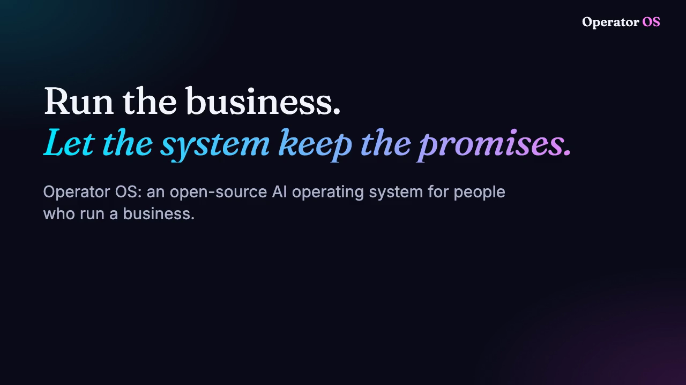
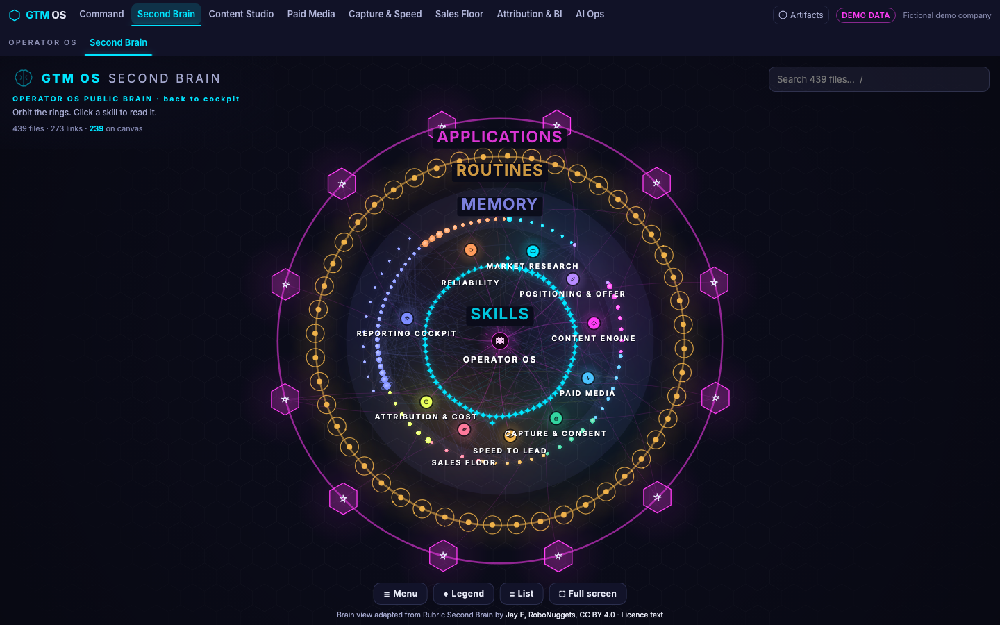
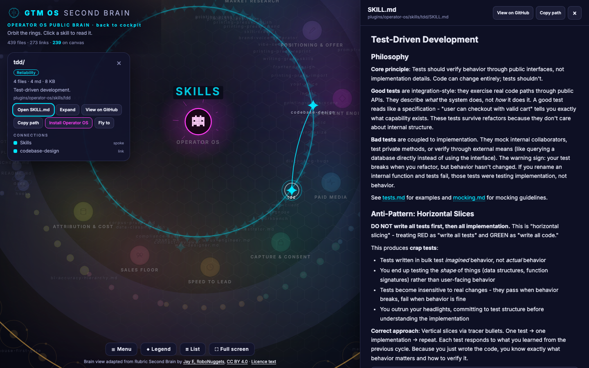
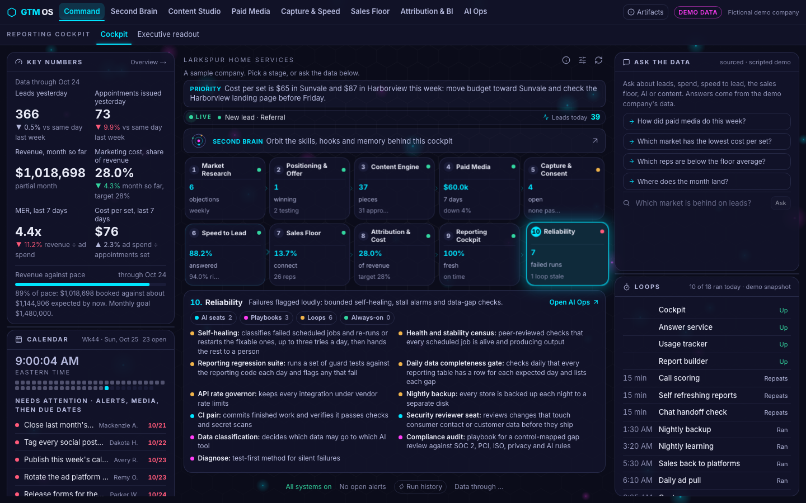
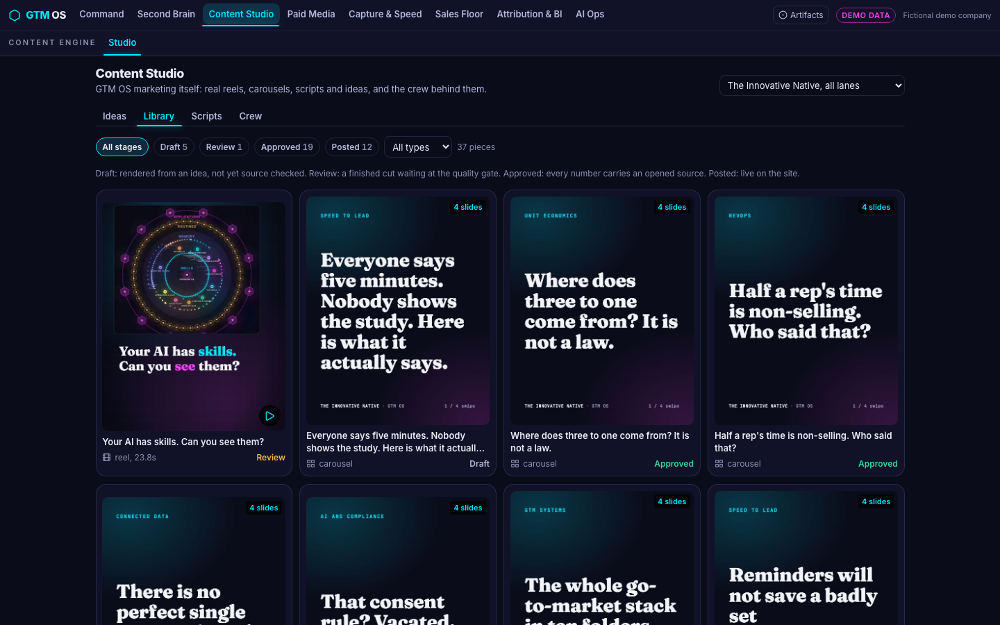
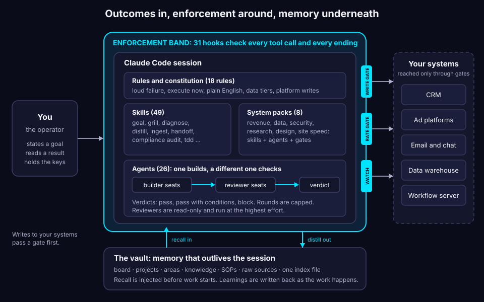
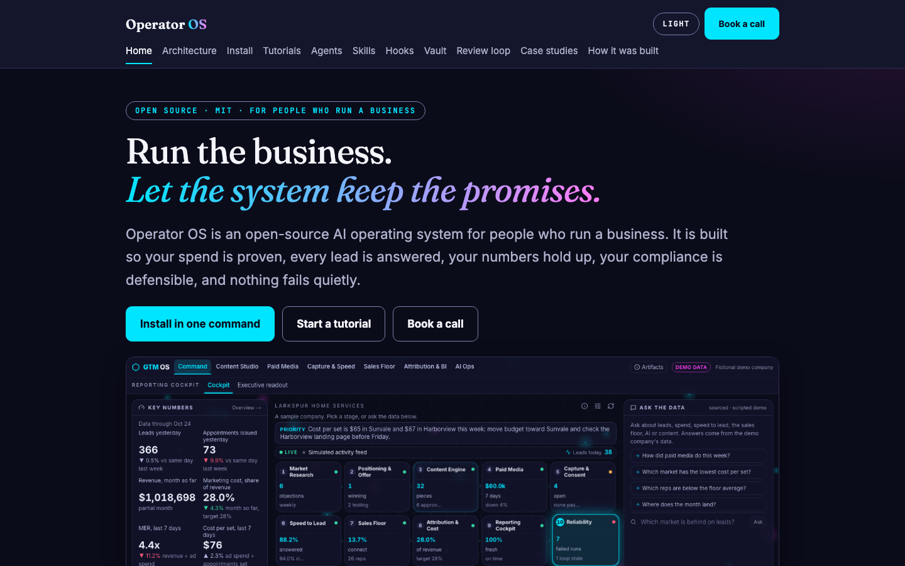
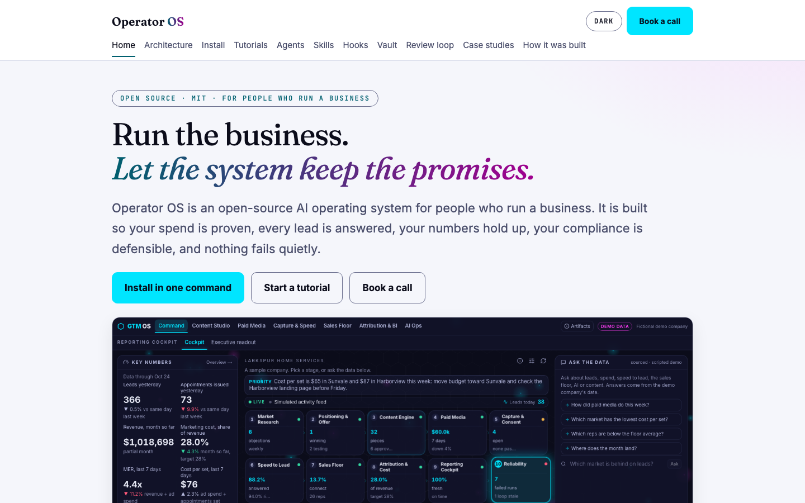
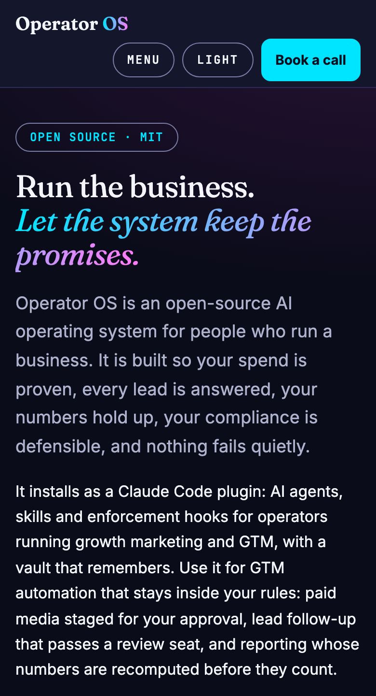

# Operator OS

**Run the business. Let the system keep the promises.**

Operator OS is a Claude Code plugin: AI agents, skills and enforcement hooks for operators running growth marketing and GTM, with a vault that remembers. It is an open-source AI operating system for people who run a business, built so your spend is proven, every lead is answered, your numbers hold up, your compliance is defensible, and nothing fails quietly.

Use it for GTM automation that stays inside your rules: paid media staged for your approval, lead follow-up that passes a review seat, and reporting whose numbers are recomputed before they count.

```
claude plugin marketplace add ndnstyl/GTM-growth && claude plugin install operator-os@operator-os
```

[Install in two minutes](https://theinnovativenative.com/operator-os/tutorial-install.html) · [Tutorials](https://theinnovativenative.com/operator-os/tutorials.html) · [Docs site](https://theinnovativenative.com/operator-os/) · **[Book a call](https://theinnovativenative.com/#book)**

[](docs/assets/walkthrough.mp4)

[Play the 25 second walkthrough](docs/assets/walkthrough.mp4) (video with controls, no autoplay)

## Where you end up, in one minute

| You get | Held in place by |
|---|---|
| **Spend proven** | a rate and cost governor on every vendor call, a write gate (the agent stages a change to an ad platform, you apply it), and a three-level check on every number |
| **Every lead answered** | a review seat that must pass any automated customer contact, a consent-evidence rule, and one registered door for new lead sources |
| **Numbers trusted** | one definition per number with its counting basis printed beside it, and a different seat checking the work |
| **Compliance defensible** | four data tiers with a routing table, a compliance audit skill, a local-only zone the cloud session cannot read, and an audit trail of every tool call |
| **Nothing failing quietly** | a write-time hook that refuses swallowed errors, deadlines on every wait, and a hook against unsupervised background processes |

## What it looks like

This is the surface a harness like this runs underneath: the public [GTM OS demo](https://theinnovativenative.com/gtm-os/brain/), with a fictional company in it. It opens on the Second Brain: every agent, skill, hook and note in Operator OS as one map you can orbit, search and open.



Click any node and its card opens; open the file and you read the real thing, the same one this repository ships.



| Command cockpit | Content Studio |
|---|---|
|  |  |

## How it fits together

In words, top to bottom: you state a goal and read a result. A band of 31 hooks and gates wraps the Claude Code session, which holds the rules, skills, agents and system packs. Your own systems sit behind the gates, and a vault gives the session memory. The diagram below is wide; on a phone, read this paragraph and open the image to zoom.



You state a goal and read a result. Everything between is wrapped in enforcement: hooks that are code, not instructions. Your real systems are reached only through gates. A vault gives the session memory that outlives it.

## Start here

Fastest first win: install, then the hook tutorial; about ten minutes together.

1. **Install** the plugin (the line above). Open a project: one status line says which optional parts are configured. [Walk-through](https://theinnovativenative.com/operator-os/tutorial-install.html).
2. **Install the rules.** Ask for the `install-rules` skill; it copies the doctrine into `.claude/rules/`.
3. **Make your vault.** Copy [`starter-vault/`](starter-vault/) or ask for `init-vault`, then set `OPERATOR_VAULT` to the folder. [Walk-through](https://theinnovativenative.com/operator-os/tutorial-vault.html).
4. **Read the example.** Open [`examples/example-vault/`](examples/example-vault/) and follow one rule from its raw source to its card.
5. **Run the loop.** Build with one seat, check with another. [Walk-through](https://theinnovativenative.com/operator-os/tutorial-review-loop.html).
6. **Add your own hook.** Block a mistake only you know about. [Walk-through](https://theinnovativenative.com/operator-os/tutorial-hook.html).
7. **Give it a goal.** Run the `goal` skill with a plain outcome and watch the gates hold.

Needs Claude Code, `jq` and `python3`. Without `jq` each hook skips itself and says so.



| Light theme | On a phone |
|---|---|
|  |  |

## What is inside

| | Count | What |
|---|---|---|
| Agents | 26 | planners, builders, read-only checkers, a video edit crew |
| Skills | 49 | goal, grill, diagnose, distill, ingest, handoff, compliance audit and more |
| Hooks | 31 registered, 3 optional | enforcement, not instruction |
| Rules | 18 | the doctrine, copied into your project |
| System packs | 8 | domain, skills, agents and gates tied together |
| Case studies | 7 | worked spec kits around an invented company, in [`docs/examples/`](docs/examples/) |
| Vault tools | 10 scripts, plus a path helper | search, lint, recall, rename, push and more |
| Example vault | about two dozen notes | a fictional company showing the method in motion |

The agent, skill and hook pages of the docs site are generated from the plugin itself: `python3 docs/build_docs.py` writes `docs/site/`, which is plain HTML and CSS, light and dark, and ready for GitHub Pages at https://theinnovativenative.com/operator-os/.

## The operating doctrine in brief

- **Loud failure.** Anything that can break ends in an error, a visible refusal or an alert row. A silent success is a bug.
- **Review loop.** One seat builds, a different seat checks, the check is bounded to a few rounds, and a halt is a valid ending.
- **Leak gate.** Sensitive data is held by code, not by a prose rule: a local-only wall, an egress watch, a secret scan, a block on naming your machine's paths.
- **Name the thing.** You never receive a ticket number. Every reference says what the thing is.
- **Execute now.** If it can be done now, it is done now. The only reason to stop is a blocker that sits on you, named on its own line.

## Check the package

```
claude plugin validate .
claude plugin validate plugins/operator-os --strict
```

## Licence and credits

MIT for the code and prose here. Skills adapted from other authors keep their own licences: see [`NOTICE.md`](NOTICE.md).

## Book a call

I work as a fractional Chief AI Officer for businesses that run growth marketing, AI and AI compliance on systems like this one. If you want it working against your own numbers, tell me what you need proven first. We start there.

**[Book a call](https://theinnovativenative.com/#book)** · [theinnovativenative.com](https://theinnovativenative.com)

Built by Mike Soto, fractional Chief AI Officer, The Innovative Native.
